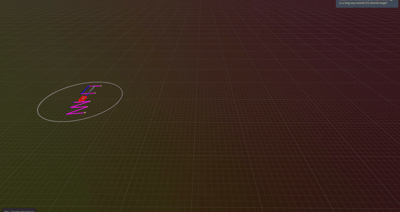
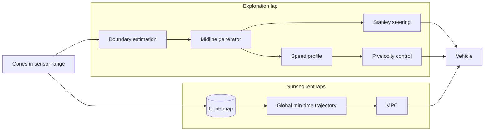

# Autonomous racing

<p align="center">
    
</p>

Planning & control pipeline for an autonomous racing car.  
Random tracks are generated using [random-track-generator](https://github.com/mvanlobensels/random-track-generator).

## Architecture

The first lap is an exploration lap: the track is unknown, so the car only sees cones within 10 m. Track boundaries are estimated from the visible cones, a midline is fitted through them and tracked with a Stanley steering controller and a P velocity controller following a speed profile. Meanwhile all observed cones are stored in a map.

After the first lap the map is used to compute a minimum-time global trajectory, tracked my an MPC, warm-started from the global solution.



## Install

```bash
uv sync
```

## Run

```bash
uv run main.py
```

