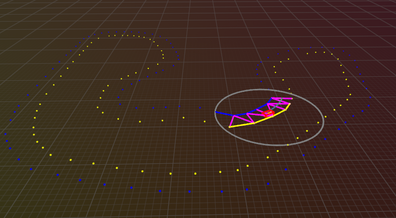

# Autonomous racing

<p align="center">
    
</p>

Planning & control pipeline for an autonomous racing car.  
Random tracks are generated using [random-track-generator](https://github.com/mvanlobensels/random-track-generator).

## Install

```bash
uv sync
```

## Run

```bash
uv run main.py
```

